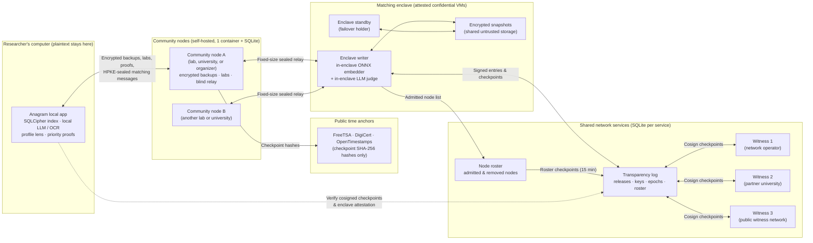

# System architecture

Anagram separates **private local work**, **community hosting**, and
**cross-community matching** so no single server can read unpublished research
or rewrite history. Every service stores its state in SQLite files (plus
encrypted snapshots for the matching enclave) — there is no external database
cluster.

> **Current status:** Community nodes, local encrypted indexing, labs, sharing,
> and priority proofs work today. Cross-community matching runs in a
> `simulated` development profile today (no hardware confidentiality yet); see
> [enclave.md](enclave.md) before using matching for sensitive work.

## 1. System overview



### Standalone community node vs. network matching

- **Matching is off by default.** A lab or organizer can run a single
  [community node](deploy.md) (`anagram node start` behind Caddy) with zero
  shared network infrastructure. Members still get local indexing, encrypted
  backups, labs, encrypted file sharing, and independently timestamped
  [priority proofs](priority-proofs.md).
- **Cross-community matching** adds the shared transparency log, roster,
  witnesses, and matching enclave ([enclave.md](enclave.md)). Nodes only relay
  fixed-size sealed messages to the enclave.

## 2. How a match flows (and what stays hidden)

```mermaid
sequenceDiagram
    participant App as Researcher app (local)
    participant Node as Community node (blind relay)
    participant Enc as Matching enclave (sealed)
    participant Log as Transparency log + 3 witnesses

    Note over App: Indexes files locally (private items excluded); user approves once
    App->>Log: Fetch cosigned checkpoint & verify enclave attestation
    App->>Node: Send HPKE-sealed pack (or fixed-size cover if matching is off)
    Node->>Enc: Relay sealed bytes (cannot read contents)
    Note over Enc: Runs in-enclave embedder & binary two-way judge with deny/block/cap rules
    Enc->>Log: Commit sealed state epoch (cosigned by witness quorum)
    Enc-->>Node: Release daily sealed slot (proposal or cover)
    Node-->>App: Deliver sealed slot
    Note over App: Proposal shows match type & own lines only (never peer identity or lines)
    App->>Node: Send sealed answer (yes / not now / no) at fixed checkpoints
    Node->>Enc: Relay sealed answer
    Note over Enc: Both answered yes -> release contact cards only; else nobody learns anything
```

## 3. Processes, storage, and operators

| Component | Command | Default port | Persistent state | Who runs it |
| --- | --- | --- | --- | --- |
| **Local app** | `anagram` | `127.0.0.1` local UI | Encrypted SQLCipher index + keys on disk | Each researcher |
| **Community node** | `anagram node start` | `8787` (behind Caddy) | `/data/node` (SQLite DBs, `keys/`, encrypted `blobs/`) | Any lab, university, or organizer |
| **Transparency log** | `anagram log serve` | `8780` | `log.sqlite` | Network operator |
| **Node roster** | `anagram roster serve` | `8782` | `roster.sqlite` | Network operator |
| **Witness 1** | `anagram witness serve --number 1` | `8781` | `witness.sqlite`, `entries.sqlite` | Network operator |
| **Witness 2** | `anagram witness serve --number 2` | `8781` | `witness.sqlite`, `entries.sqlite` | Independent university partner |
| **Witness 3** | `anagram witness serve --number 3` | `8781` | `witness.sqlite` | Independent public witness network |
| **Enclave writer & standby** | `anagram enclave serve` | `8790` | Sealed instance state + shared encrypted snapshots | Network operator inside attested CVMs |

## 4. Trust boundaries

| Party | Can see | Cannot see / cannot do |
| --- | --- | --- |
| **Community node** | Member roster (invite/ORCID/email), encrypted blob sizes, relay timing | File plaintext, index contents, matching lines, proposals, answers, or who matched whom |
| **Transparency log & witnesses** | Public release/key/epoch/roster metadata and Merkle roots | Matching packs, proposals, answers, contact cards, or research files |
| **Enclave operator (TEE profile)** | Encrypted snapshots, coarse health counters, container image | Plaintext packs, answers, or cards inside attested memory; cannot swap code or weights without a witnessed 14-day release |
| **Matched peer (after mutual Yes)** | Contact card only (name, affiliation, email/ORCID) | Your files, your index, or your matching lines |
| **Public time anchors** | SHA-256 digest of a node log checkpoint | Any finding, claim, member, or file |

## Further reading

- [Matching rules](matching.md) — proposal caps, answer windows, cooldowns, and anti-sybil quotas
- [Run a community node](deploy.md) — Docker Compose setup, backups, and organizer tools
- [Enclave operator guide](enclave.md) — running the log, witnesses, roster, and enclave instances
- [Design notes](design/README.md) & [Protocol specifications](../spec/README.md) — formal security model and wire formats
